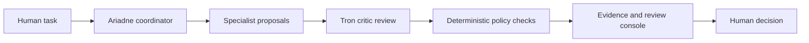

# Ariadne development progress

**September 7, 2026 · Project by James Burrows · Active development**

Ariadne explores a practical question: how can AI agents assist with useful work
while keeping decisions, permissions, and evidence understandable to a person?

The project began with a local GPU-listing evaluation demo and has grown into
work on agent coordination, human review, governance evidence, and controlled
evaluation. It also includes healthcare AI governance work samples built around
intake, risk review, monitoring, and clear ownership.

## Where the project stands

| Area | Progress | What a visitor can inspect |
| --- | --- | --- |
| Agent foundation | Published prototype for task routing, specialist recommendations, and critic review | [Master agent](../src/agent_factory/master_agent.py), [specialists](../src/agent_factory/agents/) |
| Human review | Published console and approval queue; newer local work adds stronger decision attribution and evidence binding | [Review console](../src/agent_factory/review_console.py), [queue](../src/agent_factory/action_queue.py) |
| Workflow memory | Published retrieval of approved patterns to inform recommendations | [Pattern memory](../src/agent_factory/pattern_memory.py), [tests](../tests/test_pattern_memory.py) |
| Governance work samples | Published intake, risk review, monitoring, evidence register, and operating model | [Healthcare AI governance portfolio](healthcare-ai-governance/README.md) |
| Governed evaluation | Newer local components for synthetic cases, advisory panels, evidence review, and captured readiness checks | Local development; full campaign remains incomplete |
| Release readiness | Local work on packaging, dependency inventory, diagnostics, and recovery verification | Validation and release preparation remain open |
| Integrated interface | A local review console exists; broader UI/backend integration is unfinished | No complete integrated application is claimed |

**Publication boundary:** this update publishes documentation only. The source on
the default branch remains the earlier prototype. The more recent local
governance and release-readiness implementation is not included in this update.
A clone of this repository will therefore not reproduce the newer local test
counts or features described below.

## How the design works

The current local architecture separates advice, enforcement, evidence, and
human decisions:

This is a conceptual advisory flow. A model response or a passing test does not
grant permission to execute an action. Controlled execution, where separately
enabled and approved, requires its own checks and authorization.

The published prototype includes approval-gated local-demo helpers. In the newer
local production-readiness design, the review console records decisions and
lessons without exposing an action-execution control. These are different
development snapshots, so their behavior should not be conflated.

## Recent local engineering progress

### Readiness validation component

The G03 component work checks a captured readiness record for completeness,
review timing, expected reviewers, governance mappings, conditions, and preserved
disagreement. Invalid captured readiness fails its named check.

The recorded selection of **five component test files passed 604 tests** in
31.96 seconds. Independent Tron review covered the bounded change and its
verification corrections. This result concerns synthetic component checks: it
does not authenticate real reviewers, establish external provenance, or demonstrate
that the full evaluation campaign passes.

### Test isolation and blocked-provider verification

Recent fixture work moves test-generated output into disposable directories
while retaining the real application paths and safety instrumentation.

The latest approved smoke-fixture verification stopped at a formatting check on
September 7:

| Check | Recorded result |
| --- | --- |
| Python version | Passed: 3.12 |
| Ruff lint of the candidate test file | Passed |
| Ruff formatting | Failed: leading UTF-8 byte-order mark |
| Mypy and whitespace checks | Not run after the stop |
| Six guarded smoke tests | Not run after the stop |

The proposed repair removes exactly the three leading encoding bytes. It has not
been applied or retested. Both the stopped candidate and earlier evidence remain
preserved, and Tron independently reviewed the stop.

The latest recorded full-suite attempt preceded this smoke-fixture work and
stopped at **2,385 passed and one failed**. That is a historical partial result,
not a current full-suite pass. Its failure involved a smoke fixture reaching
outside the disposable output boundary. Component selections overlap and their
counts must not be added together.

## Engineering choices worth inspecting

| Choice | Purpose | Example |
| --- | --- | --- |
| Separate proposal from permission | Keep agent recommendations from granting their own authority | [Critic implementation](../src/agent_factory/agents/tron.py) |
| Make review state explicit | Keep proposed actions and recorded decisions inspectable | [Queue tests](../tests/test_action_queue.py) |
| Retain audit records | Make it possible to examine what was proposed and reviewed | [Review console](../src/agent_factory/review_console.py) |
| Use bounded demonstrations | Exercise useful behavior with a local form and blocked submission | [Browser-plan tests](../tests/test_browser_gpu_demo_plan.py) |
| Connect governance to operations | Carry an idea through intake, risk review, monitoring, and ownership | [Governance work samples](healthcare-ai-governance/README.md) |

The newer local work also emphasizes strict data contracts, source and artifact
hashes, preservation of failed evidence, and stopping when a validation gate fails.
Python audit hooks and restricted test children are instrumentation, not an
operating-system security sandbox.

## Next milestones

1. Complete the bounded smoke-fixture correction and its approved verification.
2. Continue end-to-end validation and resolve the remaining typing, quality-baseline,
   and dependency-security evidence gaps.
3. Complete campaign execution and the remaining policy/blocker assessments.
4. Verify the UI source and integrate it with the backend.
5. Prepare a reviewed source checkpoint and complete installation, recovery, and
   release rehearsals before claiming a production-ready release.

These are development milestones, not claims that the work has been completed.

## About these work samples

The project and portfolio use local demonstrations and synthetic governance
examples. They do not establish a clinical deployment, an employer endorsement,
or legal or compliance certification. No patient records, credentials, private
runtime logs, or local verification bundles are included in this update.

For an overview, return to the [project README](../README.md). For governance
artifacts, start with the [portfolio guide](healthcare-ai-governance/README.md).

## Evidence note

The local results above were transcribed from the September 7 G03 component
review, the smoke-fixture gate results and independent stop review, and the
earlier Phase 8 full-suite report. Those local evidence bundles are not part of
this public repository. Readers can inspect the published source and tests linked
above; the newer local results are reported development progress, not independently
reproducible public CI results. No application tests were rerun to publish this
documentation.
